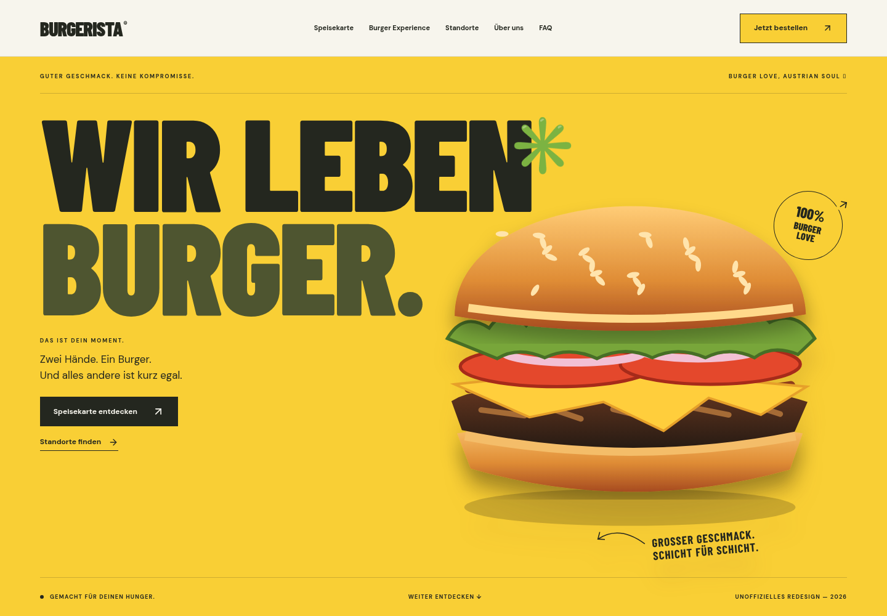

# BURGERISTA — Wir leben Burger

An independent, German-language interactive restaurant redesign concept, implemented in the existing `ayanirfan099/burgerista` repository. Not an authorized brand website or an ordering platform.

[](https://github.com/ayanirfan099/burgerista/actions/workflows/ci.yml)




## Start

Node.js 22 or 24 LTS and npm are recommended. Validated with Node 24.19.0 and npm 11.9.0.

```sh
npm ci
npm run dev
```

Open the development server on port 3000. No account, API key, database, remote images or external fonts are required.

```sh
npm run build
npm run start
npm run typecheck
npm run lint
npm test
npm run test:e2e
```

Browser tests default to the cloud machine's `/usr/bin/chromium`. On another machine install Chromium with `npx playwright install chromium`, the configuration uses Playwright's managed browser when system Chromium is absent. You can explicitly override the executable with `PLAYWRIGHT_CHROMIUM_EXECUTABLE`. Tests automatically start the production server, so build first. Screenshots and failure traces go to ignored `test-results/`.

## Experience

- Responsive sticky navigation, section tracking, mobile menu, focus containment and escape handling.
- Original animated burger hero, pointer-responsive artwork, rolling typography and reduced-motion support.
- Eleven menu names from the brief, category filters and accessible native product dialogs.
- Seven-stage scroll storytelling with a sticky, transforming ingredient composition and mobile adaptation. Uses IntersectionObserver, CSS transitions and keyframe animations. No animation runtime is needed for this sequence.
- Burger builder with base, patty, sauce, cheese and toppings. SVG preview and accessible summary update together; reset restores defaults. Clearly labeled demonstration, no cart or fictitious prices.
- Location discovery shell, ready for verified content, with an honest official-directory fallback. No invented stores or implied working map integration.
- Editorial brand concept, accessible FAQ, strong final CTA and footer.
- Legal draft routes, German metadata, generated Open Graph image, conditional canonical URL, robots.txt and sitemap.xml.
- Self-hosted licensed fonts, original SVG artwork, no third-party trackers or embedded maps.

## Architecture / editing

| File                                         | Purpose                                                                                                          |
| -------------------------------------------- | ---------------------------------------------------------------------------------------------------------------- |
| `src/lib/content.ts`                         | Typed brand, navigation, products, categories, builder options, story, FAQs, locations and official destinations |
| `src/components/Experience.tsx`              | Interactive sections, navigation state, filtering, dialogs, story observer, builder and location fallback        |
| `src/components/Burger.tsx`                  | Original layered scalable artwork; reusable across hero, menu, story and builder; unique SVG IDs                 |
| `src/app/globals.css`                        | Responsive design tokens, layout, typography, motion and reduced-motion rules                                    |
| `src/app/layout.tsx`                         | German locale, metadata, theme and global style entry                                                            |
| `src/app/page.tsx`                           | Homepage and conditional truthful WebSite structured data                                                        |
| `src/app/{impressum,datenschutz}`            | Editable, explicitly incomplete legal drafts                                                                     |
| `src/app/{robots,sitemap,opengraph-image}.*` | Search indexing and social image                                                                                 |
| `tests/unit`, `tests/e2e`                    | Content-integrity checks and real-browser interactions                                                           |
| `docs/CONTENT.md`                            | Editorial verification, assets and launch checklist                                                              |
| `docs/VALIDATION.md`                         | Actual validation results and limitations                                                                        |

### Products

Edit `products` and `categories` in `src/lib/content.ts`. Prices are nullable; retain the `Preis im Restaurant` state until verified. The model supports previous prices, promotions, ingredients, allergens, availability, vegetarian flags and order URLs, but no unsupported value is published. The copy is original concept copy, **not verified official product descriptions**. The Veggie category is based on the supplied name, not a vegan or allergen guarantee. Confirm recipes before launch. New image files can be placed in `public/`; the current cards reuse the original SVG illustration through `next/image`. When adding licensed photographs, update their paths, provide descriptive alt text and responsive sizes, and keep a source/license record.

### Locations and ordering

`locations` is intentionally empty because official data could not be retrieved. Add only owner-approved records matching its typed interface: unique ID, city, region, address, opening hours, HTTPS directions URL and optional location-specific ordering URL. The component then supports region/city filters, expandable restaurant details, directions and optional location-specific ordering links. Until then it links to the official directory. Replace the fallback only after validating actual ordering destinations. No order can be placed through this concept.

### Brand and marketing

The palette and text wordmark are independent design interpretations, not an asserted official brand guide or licensed logo. No verified testimonials, promotions, app destinations, regional-sourcing claims or founding dates were available; those are intentionally omitted. Add only substantiated, owner-approved information. See `docs/CONTENT.md`.

## Deployment to Vercel

1. Complete the content/legal/brand checks in `docs/CONTENT.md` before public release.
2. Import this existing repository in Vercel and use its Next.js framework preset, repository root, `npm ci`, and `npm run build`.
3. Use Node 22 or 24. No secrets are required.
4. For an approved public deployment, set `NEXT_PUBLIC_SITE_URL` to **your actual HTTPS concept domain**, without a trailing slash. Never use the official brand domain for an unaffiliated deployment.
5. Redeploy after changing this build-time value. With no value, metadata and robots block indexing and the sitemap is empty. With a value, the homepage receives canonical, sitemap and WebSite structured data. Legal drafts remain noindex.
6. Check generated metadata, legal content, mobile behavior and all external links on the deployed host.

No public deployment or Git push is performed automatically. Organization and Restaurant schema are deliberately omitted until the operator and individual restaurant information are approved; publishing misleading brand ownership or fictional addresses would be inappropriate.

## License / rights

Original application code and SVG illustrations were authored for this project. Font packages include their upstream SIL Open Font License notices. BURGERISTA and product marks remain their owners' property. No reference-site code, photography or proprietary artwork was copied. Obtain owner authorization and legal review before official use.
